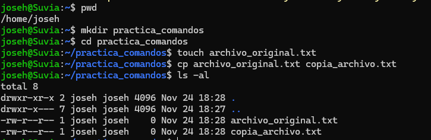
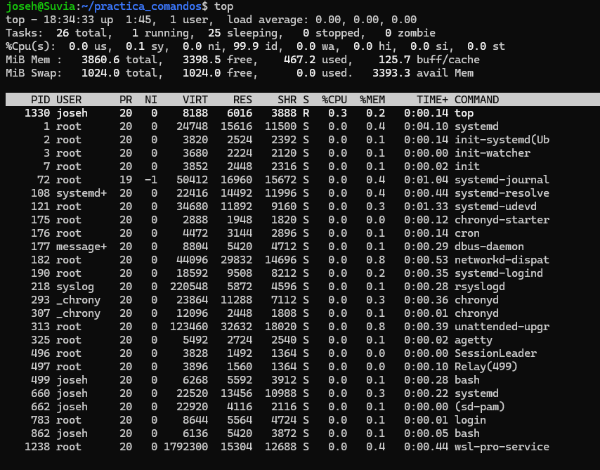
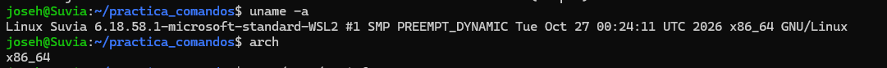
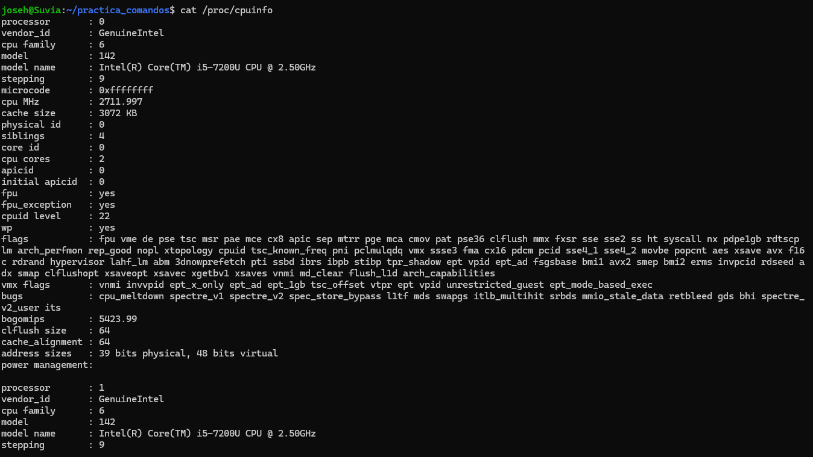
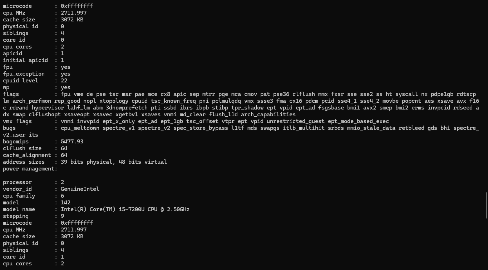
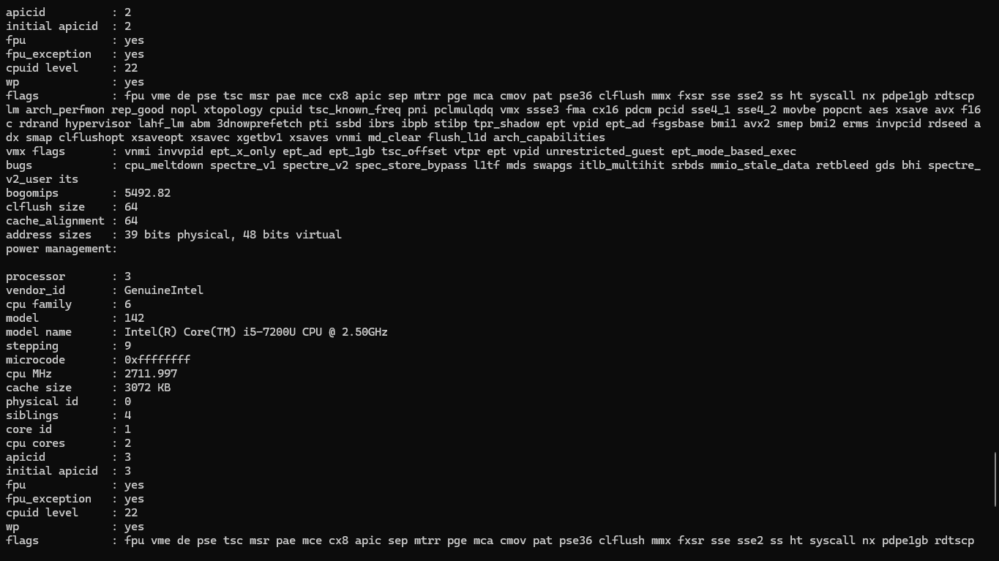
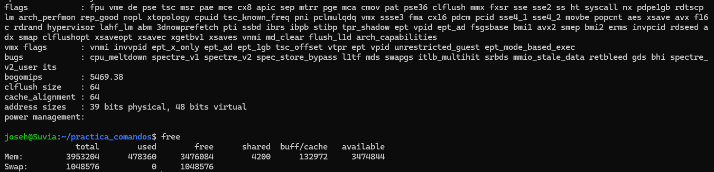
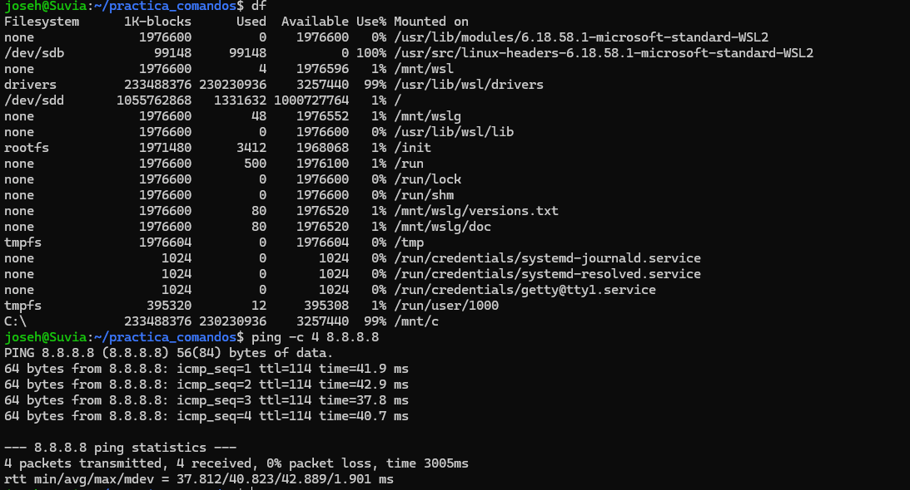

# Trabajo Práctico: Comandos Básicos, Procesos y Utilidades en Linux

**Materia:** Mantenimiento de Software  
 José Hernán Suvia  


---

## Punto 1: Gestión de Archivos, Directorios y Copias

**Comandos utilizados:**

```bash
pwd
mkdir practica_comandos
cd practica_comandos
touch archivo_original.txt
cp archivo_original.txt copia_archivo.txt
ls -al
```

**Captura:** 



**Diferencia entre `ls` y `ls -al`:**

El comando `ls` muestra los archivos y carpetas de un directorio. En cambio, `ls -al` muestra una lista detallada, incluyendo archivos ocultos, permisos, propietario, tamaño y fecha de modificación.
---

## Punto 2: Monitoreo y Control de Procesos

**Comandos utilizados:**

```bash
ps
top
```

Para salir del monitor interactivo `top`, se presionó la tecla `q`.

**Captura:**



**Diferencia entre `ps` y `top`:**

El comando `ps` muestra una lista de los procesos que se están ejecutando en ese momento en la terminal. En cambio, `top` permite monitorear los procesos de manera interactiva y en tiempo real, mostrando el consumo de CPU y memoria.

**Uso de `kill`:**

El comando `kill PID` sirve para enviar una señal a un proceso identificado por su número PID. Se utiliza, por ejemplo, para solicitar que finalice un programa que dejó de responder.
---

## Punto 3: Información del Sistema y del Kernel

**Comandos utilizados:**

```bash
uname -a
arch
cat /proc/cpuinfo
free
```

**Captura:**







**Información obtenida:**

- `uname -a`: muestra información del sistema operativo, incluyendo el nombre, la versión del Kernel y la arquitectura.
- `arch`: permite consultar la arquitectura del equipo. En este caso, el resultado fue `x86_64`.
- `cat /proc/cpuinfo`: muestra información detallada del procesador, como el modelo y sus características.
- `free`: permite consultar el estado de la memoria RAM y la memoria Swap, mostrando la cantidad total, utilizada y disponible.
---

## Punto 4: Diagnóstico de Red y Espacio en Disco

**Comandos utilizados:**

```bash
df
ping -c 4 8.8.8.8
```

**Captura:**



**Funcionamiento de `df`:**

El comando `df` permite consultar el espacio disponible y utilizado en los sistemas de archivos, mostrando información sobre el almacenamiento.

**Funcionamiento de `ping`:**

El comando `ping` permite comprobar la conectividad entre dos dispositivos dentro de una red TCP/IP. Envía paquetes de prueba a una dirección IP y espera una respuesta. También permite conocer el tiempo que tardan los paquetes en llegar y si existe pérdida de información.

En la prueba realizada se enviaron 4 paquetes a la dirección `8.8.8.8`. Se recibieron los 4 paquetes, con un resultado de 0 % de pérdida.
