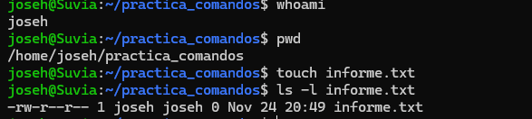
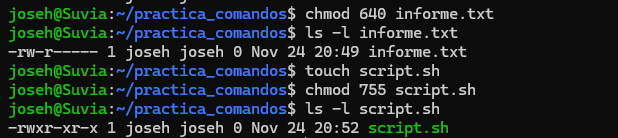
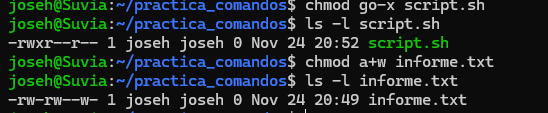
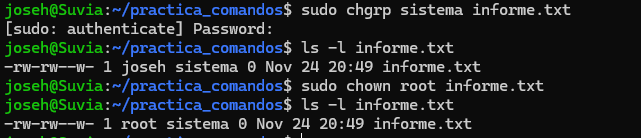
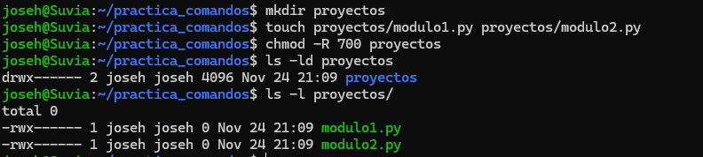

# Trabajo Práctico: Permisos de Archivos, Directorios y Propiedad en Linux

- **Materia:** Mantenimiento de Software
- **Estudiante:** Jose Hernan Suvia


---

## 1. Lectura e interpretación de permisos (`ls -l`)

### Comandos ejecutados

```bash
touch informe.txt
ls -l informe.txt
```

### Resultado obtenido

```text
-rw-r--r-- 1 joseh joseh 0 Nov 24 20:49 informe.txt
```

### Explicación

El primer carácter indica el tipo de elemento:

- `-`: archivo regular.
- `d`: directorio.
- `l`: enlace simbólico.

Los nueve caracteres siguientes representan los permisos del propietario, grupo y otros.

| Categoría | Permisos | Significado |
|---|---|---|
| Propietario (`u`) | `rw-` | Lectura y escritura |
| Grupo (`g`) | `r--` | Solo lectura |
| Otros (`o`) | `r--` | Solo lectura |

Los caracteres de permisos significan:

- `r`: lectura.
- `w`: escritura.
- `x`: ejecución.
- `-`: permiso no concedido.

### Captura de pantalla




---

## 2. Asignación de permisos en modo octal (`chmod`)

### Comandos ejecutados

```bash
chmod 640 informe.txt
ls -l informe.txt

touch script.sh
chmod 755 script.sh
ls -l script.sh
```

### Resultado de `informe.txt`

```text
-rw-r----- 1 joseh joseh 0 Nov 24 20:49 informe.txt
```

### Cálculo matemático de 640

Los valores de los permisos son:

- Lectura (`r`) = 4.
- Escritura (`w`) = 2.
- Ejecución (`x`) = 1.

Desglose:

- Propietario: 4 + 2 = **6**.
- Grupo: 4 = **4**.
- Otros: 0 = **0**.

Por lo tanto, `640` significa lectura y escritura para el propietario, lectura para el grupo y ningún permiso para otros.

### Resultado de `script.sh`

```text
-rwxr-xr-x 1 joseh joseh 0 Nov 24 20:52 script.sh
```

### Cálculo matemático de 755

- Propietario: 4 + 2 + 1 = **7**.
- Grupo: 4 + 1 = **5**.
- Otros: 4 + 1 = **5**.

Por lo tanto, `755` significa lectura, escritura y ejecución para el propietario, y lectura y ejecución para el grupo y otros.

### Captura de pantalla




---

## 3. Asignación de permisos en modo simbólico

### Comandos ejecutados

```bash
chmod go-x script.sh
ls -l script.sh

chmod a+w informe.txt
ls -l informe.txt
```

### Resultado de `script.sh`

```text
-rwxr--r-- 1 joseh joseh 0 Nov 24 20:52 script.sh
```

Se quitó el permiso de ejecución al grupo (`g`) y a otros (`o`).

### Resultado de `informe.txt`

```text
-rw-rw--w- 1 joseh joseh 0 Nov 24 20:49 informe.txt
```

Se agregó el permiso de escritura a todos (`a`).

### Ventaja del modo simbólico

La ventaja de utilizar permisos simbólicos es que permite modificar permisos específicos sin reemplazar los demás.

Por ejemplo, `chmod go-x script.sh` quita solamente el permiso de ejecución al grupo y a otros, conservando los demás permisos existentes.

### Captura de pantalla




---

## 4. Cambio de propietario y grupo (`chown` y `chgrp`)

### Verificación previa

Antes de ejecutar los comandos, se comprobó la existencia de los usuarios y grupos:

- El grupo `sistema` existía.
- El grupo `docentes` no existía.
- El usuario `marta` no existía.

Por este motivo, se utilizó el grupo existente `sistema` y el usuario administrador `root`.

### Comandos ejecutados

```bash
sudo chgrp sistema informe.txt
ls -l informe.txt

sudo chown root informe.txt
ls -l informe.txt
```

### Resultado obtenido

```text
-rw-rw--w- 1 root sistema 0 Nov 24 20:49 informe.txt
```

El propietario cambió de `joseh` a `root` y el grupo cambió de `joseh` a `sistema`.

### ¿Por qué se necesita `sudo` o el usuario root?

Para cambiar el propietario de un archivo se necesitan privilegios administrativos.

Un usuario común no puede transferir libremente la propiedad de sus archivos a otros usuarios. Por eso se utiliza `sudo`, que permite ejecutar el comando con permisos de administrador.

### Captura de pantalla




---

## 5. Permisos recursivos sobre carpetas (`chmod -R`)

### Comandos ejecutados

```bash
mkdir proyectos
touch proyectos/modulo1.py proyectos/modulo2.py
chmod -R 700 proyectos
ls -ld proyectos
ls -l proyectos/
```

### Resultado del directorio

```text
drwx------ 2 joseh joseh 4096 Nov 24 21:09 proyectos
```

### Resultado de los archivos

```text
-rwx------ 1 joseh joseh 0 Nov 24 21:09 modulo1.py
-rwx------ 1 joseh joseh 0 Nov 24 21:09 modulo2.py
```

### Explicación

El parámetro `-R` del comando `chmod` permite aplicar los cambios de permisos de manera recursiva, es decir, al directorio principal y a todos los archivos y subdirectorios que contiene.

El valor `700` significa:

- **Propietario:** lectura, escritura y ejecución (`7`).
- **Grupo:** ningún permiso (`0`).
- **Otros:** ningún permiso (`0`).

### Importancia del permiso de ejecución (`x`) en un directorio

El permiso de ejecución en un directorio permite acceder a él y recorrerlo para llegar a sus archivos y subdirectorios.

Si se quita este permiso, los usuarios afectados no podrán acceder ni recorrer normalmente su contenido, aunque tengan otros permisos.

### Captura de pantalla



