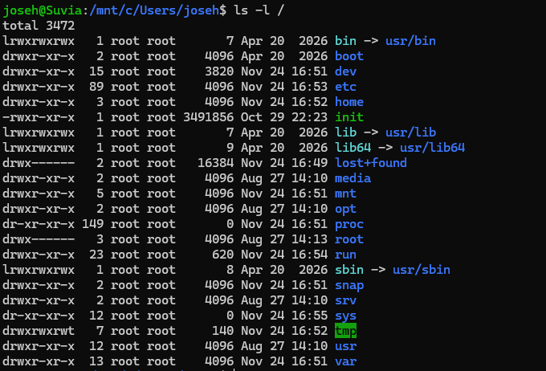
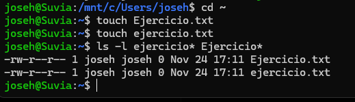
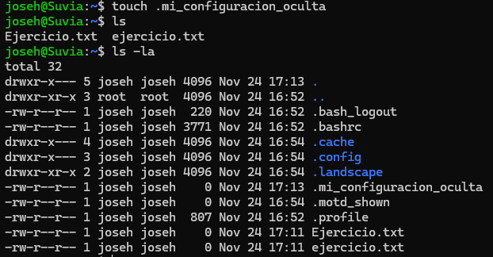
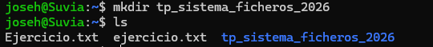
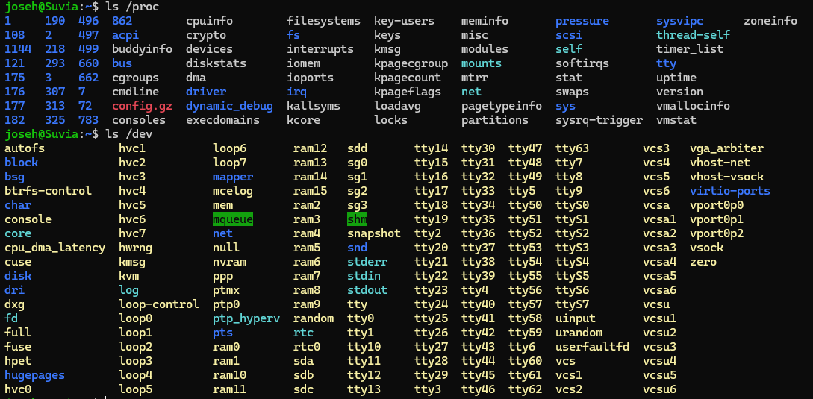

# Trabajo Práctico: Exploración del Sistema de Archivos en Linux

## Mantenimiento de Software

**Alumno:** José Hernán Suvia

## Introducción

En este trabajo práctico se realizó una exploración del sistema de archivos de Linux utilizando Ubuntu mediante WSL (Windows Subsystem for Linux).

El objetivo fue conocer cómo está organizado el sistema de archivos, identificar sus principales directorios y realizar diferentes operaciones mediante comandos desde la terminal.

A continuación, se presentan los cinco ejercicios realizados, con sus respectivos comandos, explicaciones y capturas de pantalla.

## Ejercicio 1: Estructura del árbol de directorios

**Comando utilizado:**

```bash
ls -l /
```

**Desarrollo:**

Se utilizó el comando `ls -l /` para visualizar el contenido del directorio raíz del sistema Linux.

Al ejecutar el comando, se pudieron observar los principales directorios que forman parte de la estructura del sistema.

Entre ellos se identificaron:

- `/etc`: contiene archivos de configuración del sistema.
- `/home`: almacena las carpetas personales de los usuarios.
- `/dev`: contiene archivos que representan dispositivos.
- `/var`: almacena archivos variables del sistema, como registros.

**Captura de pantalla:**



## Ejercicio 2: Sensibilidad a mayúsculas y minúsculas

**Comandos utilizados:**

```bash
touch Ejercicio.txt
touch ejercicio.txt
ls -l ejercicio* Ejercicio*
```

**Desarrollo:**

Se crearon dos archivos con nombres similares, diferenciándose únicamente por la primera letra, una mayúscula y otra minúscula.

Al ejecutar el comando de visualización se comprobó que Linux distingue entre mayúsculas y minúsculas.

Por lo tanto, `Ejercicio.txt` y `ejercicio.txt` son considerados dos archivos diferentes y pueden existir dentro del mismo directorio.

**Captura de pantalla:**



## Ejercicio 3: Archivos ocultos

**Comandos utilizados:**

```bash
touch .mi_configuracion_oculta
ls
ls -la
```

**Desarrollo:**

Se creó un archivo cuyo nombre comienza con un punto (`.`), característica que identifica a los archivos ocultos en Linux.

Al ejecutar el comando `ls`, el archivo no apareció en la lista de elementos del directorio.

Luego, utilizando el comando `ls -la`, se pudo visualizar correctamente el archivo oculto junto con los demás archivos y directorios.

De esta manera, se comprobó que en Linux los archivos cuyo nombre comienza con un punto se consideran ocultos.

**Captura de pantalla:**



## Ejercicio 4: Buenas prácticas en nombres de archivos

**Comandos utilizados:**

```bash
mkdir tp_sistema_ficheros_2026
ls
```

**Desarrollo:**

Se creó un nuevo directorio utilizando el comando `mkdir`.

Se utilizó el nombre `tp_sistema_ficheros_2026`, aplicando buenas prácticas para nombrar archivos y carpetas, como utilizar letras minúsculas, evitar espacios y separar las palabras mediante guiones bajos.

Finalmente, se ejecutó el comando `ls` para comprobar que el directorio se había creado correctamente.

**Captura de pantalla:**



## Ejercicio 5: Exploración de dispositivos y procesos

**Comandos utilizados:**

```bash
ls /proc
ls /dev
```

**Desarrollo:**

Se exploraron los directorios `/proc` y `/dev` mediante los comandos correspondientes.

En `/proc` se visualizaron archivos y directorios relacionados con información de los procesos y el estado del sistema.

En `/dev` se observaron archivos especiales que representan dispositivos disponibles en Linux.

De esta manera, se pudo conocer la función de ambos directorios dentro de la estructura del sistema operativo.

**Captura de pantalla:**


