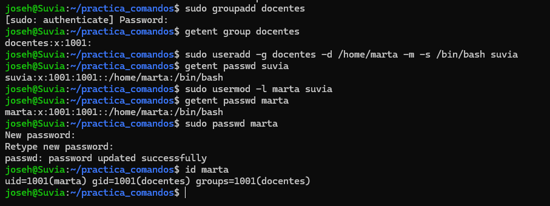
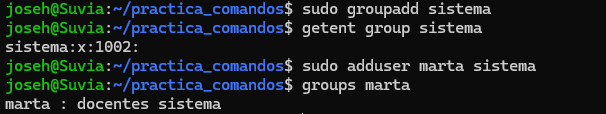
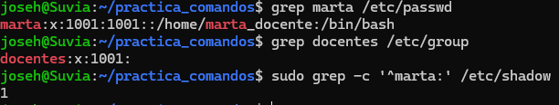
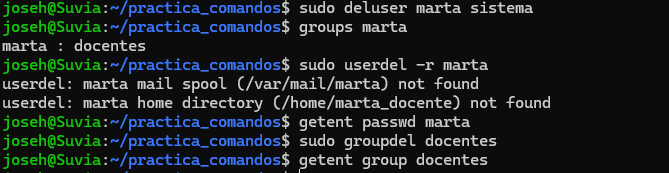

# Trabajo Usuarios y Grupos en Linux

**Materia:** Mantenimiento de Software

**Sistema operativo:** Ubuntu Linux (WSL2)

## Introducción

En este trabajo práctico se realizaron diferentes operaciones de administración de usuarios y grupos en Linux utilizando la terminal de Ubuntu.

Se trabajó con la creación de grupos y usuarios, la asignación de grupos secundarios, la modificación de parámetros de usuario, la inspección de archivos de configuración y la eliminación de cuentas y grupos.

El objetivo es comprender cómo se administran los usuarios y grupos en un sistema Linux mediante comandos de terminal.
## Ejercicio 1: Creación de Grupos y Usuarios con Directorio Personal

Primero se creó el grupo `docentes` mediante el siguiente comando:

```bash
sudo groupadd docentes
```

Luego se creó el usuario `marta`, asignándole el grupo principal `docentes`, su directorio personal y el intérprete de comandos Bash.

```bash
sudo useradd -g docentes -d /home/marta -m -s /bin/bash marta
```

A continuación, se estableció una contraseña para el usuario:

```bash
sudo passwd marta
```

Finalmente, se verificó la creación del usuario mediante:

```bash
id marta
```

### Explicación de la opción -m

La opción `-m` del comando `useradd` permite crear automáticamente el directorio personal del usuario, en este caso `/home/marta`.

Si se omite esta opción, el directorio personal no se crea automáticamente, aunque se haya indicado su ruta mediante `-d`.

### Resultado

Se creó correctamente el grupo `docentes` y el usuario `marta`, asignándole su grupo principal y configurando su directorio personal.


## Ejercicio 2: Gestión de Grupos Secundarios

En este ejercicio se creó un segundo grupo llamado `sistema`:

```bash
sudo groupadd sistema
```

Luego se agregó al usuario `marta` como miembro secundario del grupo `sistema`:

```bash
sudo adduser marta sistema
```

Para comprobar que el usuario pertenece a ambos grupos, se ejecutó:

```bash
groups marta
```

### ¿Cómo quitar a un usuario de un grupo secundario?

Para quitar a un usuario de un grupo secundario se puede utilizar el siguiente comando:

```bash
sudo deluser marta sistema
```

Este comando elimina a `marta` del grupo secundario `sistema`, pero conserva su pertenencia al grupo principal `docentes`.

### Resultado

Se agregó correctamente al usuario `marta` al grupo secundario `sistema`. La comprobación permitió verificar su pertenencia a los grupos `docentes` y `sistema`.



## Ejercicio 3: Modificación de Parámetros de Usuario

En este ejercicio se modificó el directorio personal del usuario `marta` mediante el comando:

```bash
sudo usermod -d /home/marta_docente marta
```

Este comando permite cambiar el directorio personal registrado para el usuario `marta`, estableciendo como nueva ruta `/home/marta_docente`.

Para comprobar que la modificación se realizó correctamente, se ejecutó:

```bash
getent passwd marta
```

El resultado permitió verificar que el nuevo directorio personal quedó registrado correctamente.

### Diferencia entre useradd y usermod

- `useradd`: se utiliza para crear nuevos usuarios en el sistema.
- `usermod`: se utiliza para modificar los datos y parámetros de usuarios que ya existen.

### Resultado

Se modificó correctamente la ruta del directorio personal del usuario `marta`, conservando su cuenta y su grupo principal.


## Ejercicio 4: Inspección de Ficheros de Configuración

En este ejercicio se inspeccionaron los archivos de configuración de Linux para consultar la información de los usuarios y grupos.

Primero, se buscó el usuario `marta` en el archivo `/etc/passwd`:

```bash
grep marta /etc/passwd
```

Luego, se buscó el grupo `docentes` en el archivo `/etc/group`:

```bash
grep docentes /etc/group
```

Finalmente, se comprobó que el usuario `marta` tuviera una entrada en el archivo protegido `/etc/shadow`:

```bash
sudo grep -c '^marta:' /etc/shadow
```

El resultado fue `1`, confirmando que existe una entrada para dicho usuario.

### Descripción de los archivos de configuración

**/etc/passwd**

Contiene información de las cuentas de usuario del sistema, como el nombre de usuario, UID, GID, directorio personal y shell asignado.

**/etc/group**

Contiene información sobre los grupos del sistema, incluyendo el nombre del grupo, su identificador GID y los usuarios que pertenecen a él.

**/etc/shadow**

Almacena información protegida relacionada con las contraseñas de los usuarios, sus hashes y datos de caducidad. Su contenido está restringido por motivos de seguridad.

### Resultado

Se consultaron correctamente los archivos `/etc/passwd` y `/etc/group`, y se verificó la existencia de la entrada de `marta` en `/etc/shadow` sin mostrar información sensible.



## Ejercicio 5: Eliminación de Cuentas y Grupos

En este ejercicio se realizaron las operaciones necesarias para eliminar un usuario y sus grupos en Linux.

Primero, se quitó al usuario `marta` del grupo secundario `sistema` mediante el comando:

```bash
sudo deluser marta sistema
```

Luego, se comprobó que el usuario ya no perteneciera al grupo secundario:

```bash
groups marta
```

El resultado mostró que `marta` solamente pertenecía al grupo principal `docentes`.

A continuación, se eliminó la cuenta del usuario:

```bash
sudo userdel -r marta
```

Finalmente, se eliminó el grupo `docentes`:

```bash
sudo groupdel docentes
```

### ¿Qué hace la opción -r?

La opción `-r` del comando `userdel` permite eliminar también el directorio personal del usuario y su buzón de correo, si existen.

### ¿Cuál es el requisito para eliminar un grupo con groupdel?

Para eliminar un grupo mediante `groupdel`, este no debe ser el grupo principal de ningún usuario existente en el sistema.

### Resultado

Se eliminó correctamente al usuario `marta`, se comprobó que ya no pertenecía al grupo secundario `sistema` y finalmente se eliminó el grupo `docentes`.


